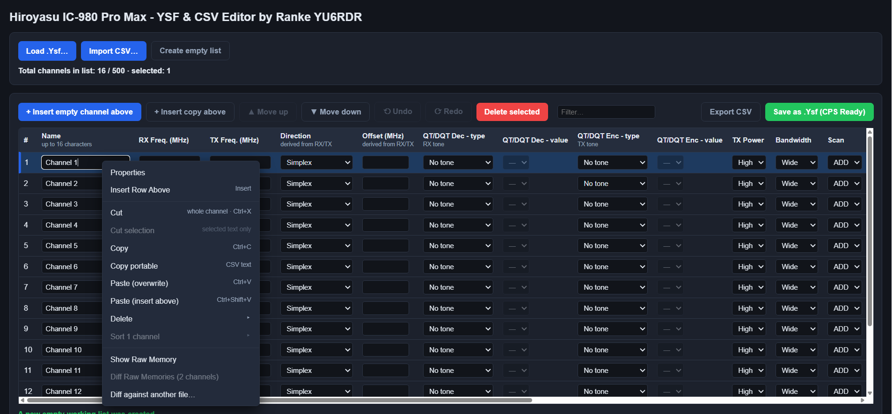

https://idrugiput-netizen.github.io/hiroyasu-ic980-pro-max-editor/
# Hiroyasu IC-980 Pro Max Channel Editor

Standalone HTML channel editor for the Hiroyasu IC-980 Pro Max radio. Easily edit parameters, move, copy, or insert channels, and import CHIRP CSV files. Saves everything locally into a fresh, formatted .ysf file that is 100% compatible and ready for the official Hiroyasu CPS software. No installation needed, runs fully offline in browser.
